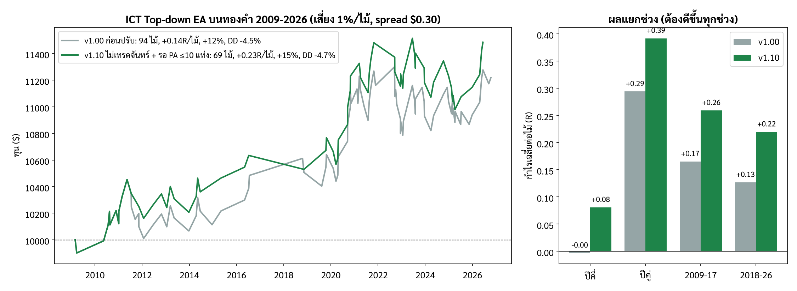

# ICT Top-down EA (MetaTrader 5)

ไฟล์: `MQL5/Experts/ICT_TopDown_EA.mq5` — ตรรกะเดียวกับ `backtest/sim_m1.py`
ย้อนกลับไปสถานะก่อนมี EA ตัวนี้: ดู `CHECKPOINT.md`

## หลักการ: ดูจาก TF ใหญ่ลงมา TF เล็ก
| ขั้น | ทำอะไร |
|---|---|
| 1. โซน TF ใหญ่ | Swing H1, Swing H4 (แรง 3 แท่ง) ที่ยังไม่ถูกแตะ + PDH/PDL |
| 2. Sweep | ราคา M1 แทงผ่านโซน ถ้าแทงลึกเกิน 3×ATR(M5) = เบรคจริง ทิ้ง |
| 3. PA ที่ไส้ | Pin bar / Engulfing / Star บน M1 ภายใน 3 แท่งจากจุดสุดของไส้ |
| 4. MSS | M1 ปิดกลับเข้าโซน + ปิดทะลุ swing M1 ด้วยแท่ง displacement (≥1×ATR M1) ภายใน 30 แท่ง |
| 5. FVG + PA | เจอ FVG บน M1 แล้วรอราคาย่อเข้า FVG + แท่งปฏิเสธ ภายใน **10 แท่ง** → เข้า Market |
| 6. SL | **พ้นโซน TF ใหญ่ 1.5×ATR ของ TF โซน** (H1 ใช้ ATR H1, H4/PDH/PDL ใช้ ATR H4) |
| 7. TP | **swing ล่าสุดก่อนจุดกลับตัว** บน TF ของโซน (ต้นขาที่ลงมากวาดโซน) RR ต้อง ≥ 0.8 |
| 8. จัดการ | ถึง 1R → ปิด 50% + เลื่อน SL กันทุน +10 points |
| เวลา | London 02:00-05:00 และ NY 07:00-10:00 (เวลานิวยอร์ก), **ไม่เทรดวันจันทร์**, สูงสุด 2 ไม้/วัน |

setup ถูกคัดด้วย SL ตามโครงสร้าง M1 (ไส้ + 0.5 ATR M1): ต้องไม่เกิน 3×ATR(M5) และ spread ≤ 20% ของระยะนั้น

## ใช้กับทองคำเท่านั้น
EA ตรวจชื่อสัญลักษณ์ตอนเริ่ม ถ้าไม่มีคำว่า `XAU` หรือ `GOLD` (เช่น XAUUSD, XAUUSDm, GOLD) จะแจ้งเตือนและไม่ทำงาน
เหตุผล: ทดสอบแล้วใช้ไม่ได้กับ EURUSD (ติดลบทุกชุดค่า) และค่าทั้งหมดปรับมาจากข้อมูลทอง

## ติดตั้ง
1. คัดลอกไฟล์ไป `MQL5/Experts/` แล้ว Compile ใน MetaEditor
2. ใส่ในกราฟ XAUUSD TF ใดก็ได้ (EA อ่าน M1/M5/H1/H4/D1 เอง)
3. ตั้ง `InpServerMinusNY` ให้ตรงกับโบรก (ส่วนใหญ่ = 7)
4. ทอง 3 ทศนิยม: `InpBEPlusPoints` = 100, `InpMaxSpreadPoints` ~ 400-600

## ผล backtest (Python, XAUUSD M1 2009-2026, spread $0.30, เสี่ยง 1%)
| เวอร์ชัน | ไม้ | Win% | เฉลี่ย/ไม้ | PF | ผลรวม | Max DD | t |
|---|---|---|---|---|---|---|---|
| v1.00 | 94 | 56.4 | +0.139R | 1.29 | +12% | -4.5% | 1.3 |
| **v1.10** (ไม่เทรดจันทร์ + รอ PA ≤ 10 แท่ง) | 69 (≈4/ปี) | 59.4 | **+0.234R** | 1.51 | +15% | -4.7% | 1.8 |

### วิธีเลือกการปรับใน v1.10 (`backtest/screen.py`)
ลอง 40 การปรับที่มีเหตุผลตาม ICT ทีละข้อ รับเฉพาะข้อที่ดีขึ้น ≥ 0.02R **ทั้งปีคี่และปีคู่** (ข้อมูล 2 ชุดที่ไม่ทับกัน) และไม้ไม่หายเกินครึ่ง
ผ่าน 2 ข้อ: ไม่เทรดวันจันทร์, รอ PA ใน FVG ≤ 10 แท่ง (6/8/10/12 แท่งดีกว่า 15 ทั้งหมด จึงไม่ใช่ค่าบังเอิญ)
ไม่ผ่าน (ไม่ได้ใส่): bias H1/H4, P/D, Silver Bullet, NY 8-11, ปรับ displacement/FVG, trailing, เปลี่ยนจุดกันทุน ฯลฯ
หลังรวม: ดีขึ้นทุกช่วง (ปีคี่ -0.00→+0.08, ปีคู่ +0.29→+0.39, 2009-17 +0.17→+0.26, 2018-26 +0.13→+0.22) และ SL 1.25 / 1.75 ATR ก็บวก (+0.13 / +0.15)

ทางเลือกที่ไม่ได้ตั้งเป็นค่าเริ่มต้น: `InpTPMode = TD_TP_RR` (2R) ได้ 126 ไม้ +0.195R t=2.0 แต่ Max DD -9.8%

- ยัง**ไม่มีนัยสำคัญทางสถิติ** (t = 1.8 < 2) และค่าหลายตัวถูกเลือกหลังเห็นผล → ผลจริงน่าจะต่ำกว่านี้
- Sell (+0.23R, 54 ไม้) ดีกว่า Buy (+0.01R, 40 ไม้)
- SL กลาง ~$8 → ทุน $10,000 เสี่ยง 1% ได้ ~0.12 lot; ทุนเล็กอาจต่ำกว่า lot ขั้นต่ำ (EA จะไม่เข้า)

## ต่างจาก backtest เล็กน้อย
- EA ใช้ spread จริง, มีลิมิตขาดทุนรายวัน 3% และตัวกรอง spread สูงสุด (backtest ไม่มี)
- ตอนเริ่ม EA จะเติมโซน H1/H4 ที่ยังไม่ถูกแตะจากประวัติ 300 แท่ง (backtest สะสมไปเรื่อยๆ)
- ยังไม่ได้ compile (ไม่มี MetaEditor ในเครื่องที่เขียน) ถ้ามี error ส่งข้อความมาแก้ได้

## ขั้นต่อไปที่แนะนำ
1. Compile แล้วรันใน Strategy Tester (Every tick based on real ticks) ช่วงปีล่าสุด เทียบกับตารางด้านบน
2. Forward test บนบัญชีเดโมอย่างน้อย 3-6 เดือน (ไม้น้อย ~5/ปี → ต้องใช้เวลานาน)
