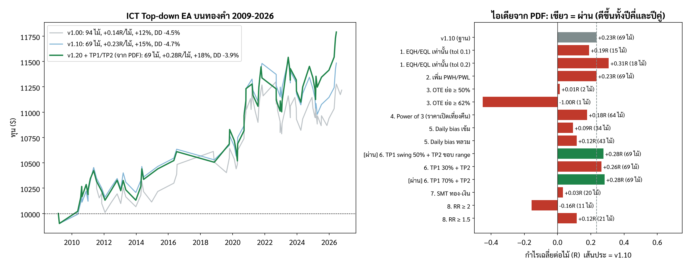

# ICT Top-down EA (MetaTrader 5)

ไฟล์: `MQL5/Experts/ICT_TopDown_EA.mq5` — ตรรกะเดียวกับ `backtest/sim_m1.py`
ย้อนกลับไปสถานะก่อนมี EA ตัวนี้: ดู `CHECKPOINT.md`

## หลักการ: ดูจาก TF ใหญ่ลงมา TF เล็ก
| ขั้น | ทำอะไร |
|---|---|
| 1. โซน TF ใหญ่ | Swing H1, Swing H4 (แรง 3 แท่ง) ที่ยังไม่ถูกแตะ + PDH/PDL |
| 2. Sweep | ราคา M1 แทงผ่านโซน ถ้าแทงลึกเกิน 3×ATR(M5) = เบรคจริง ทิ้ง |
| 3. PA ที่ไส้ | Pin bar / Engulfing / Star บน M1 ภายใน 3 แท่งจากจุดสุดของไส้ |
| 4. MSS | M1 ปิดกลับเข้าโซน + ปิดทะลุ swing M1 ด้วยแท่ง displacement (≥1×ATR M1) ภายใน 30 แท่ง · **แท่ง MSS ต้องมี tick volume มากกว่าค่าเฉลี่ย 50 แท่ง** (v1.30) |
| 5. FVG + PA | เจอ FVG บน M1 แล้วรอราคาย่อเข้า FVG + แท่งปฏิเสธ ภายใน **10 แท่ง** → เข้า Market |
| 6. SL | **พ้นโซน TF ใหญ่ 1.5×ATR ของ TF โซน** (H1 ใช้ ATR H1, H4/PDH/PDL ใช้ ATR H4) |
| 7. TP1 | **swing ล่าสุดก่อนจุดกลับตัว** บน TF ของโซน (ต้นขาที่ลงมากวาดโซน) RR ต้อง ≥ 0.8 → ปิด 50% + เลื่อน SL กันทุน +10 points |
| 8. TP2 | **ขอบ dealing range** (สูง/ต่ำสุดตั้งแต่โซนเกิดถึงจุดกวาด) สำหรับไม้ที่เหลือ ถ้าไม่ไกลกว่า TP1 → ปิดทั้งหมดที่ TP1 ไม่กันทุน |
| เวลา | London 02:00-05:00 และ NY 07:00-10:00 (เวลานิวยอร์ก), **ไม่เทรดวันจันทร์**, สูงสุด 2 ไม้/วัน |

setup ถูกคัดด้วย SL ตามโครงสร้าง M1 (ไส้ + 0.5 ATR M1): ต้องไม่เกิน 3×ATR(M5) และ spread ≤ 20% ของระยะนั้น

## ใช้กับทองคำเท่านั้น
EA ตรวจชื่อสัญลักษณ์ตอนเริ่ม ถ้าไม่มีคำว่า `XAU` หรือ `GOLD` (เช่น XAUUSD, XAUUSDm, GOLD) จะแจ้งเตือนและไม่ทำงาน
เหตุผล: ทดสอบแล้วใช้ไม่ได้กับ EURUSD (ติดลบทุกชุดค่า) และค่าทั้งหมดปรับมาจากข้อมูลทอง

## ติดตั้ง
1. คัดลอกไฟล์ไป `MQL5/Experts/` แล้ว Compile ใน MetaEditor
2. ใส่ในกราฟ XAUUSD TF ใดก็ได้ (EA อ่าน M1/M5/H1/H4/D1 เอง)
3. ตั้ง `InpServerMinusNY` ให้ตรงกับโบรก (ส่วนใหญ่ = 7)
4. ทอง 3 ทศนิยม: `InpBEPlusPoints` = 100, `InpMaxSpreadPoints` ~ 400-600

## ผล backtest (Python, XAUUSD M1 2009-2026, spread $0.30, เสี่ยง 1%)
| เวอร์ชัน | ไม้ | Win% | เฉลี่ย/ไม้ | PF | ผลรวม | Max DD | t |
|---|---|---|---|---|---|---|---|
| v1.00 | 94 | 56.4 | +0.139R | 1.29 | +12% | -4.5% | 1.3 |
| v1.10 (ไม่เทรดจันทร์ + รอ PA ≤ 10 แท่ง) | 69 | 59.4 | +0.234R | 1.51 | +15% | -4.7% | 1.8 |
| **v1.20** (+ TP1 swing / TP2 ขอบ range จาก PDF) | 69 (≈4/ปี) | 56.5 | **+0.276R** | 1.57 | +18% | -3.9% | 1.9 |

### วิธีเลือกการปรับใน v1.10 (`backtest/screen.py`)
ลอง 40 การปรับที่มีเหตุผลตาม ICT ทีละข้อ รับเฉพาะข้อที่ดีขึ้น ≥ 0.02R **ทั้งปีคี่และปีคู่** (ข้อมูล 2 ชุดที่ไม่ทับกัน) และไม้ไม่หายเกินครึ่ง
ผ่าน 2 ข้อ: ไม่เทรดวันจันทร์, รอ PA ใน FVG ≤ 10 แท่ง (6/8/10/12 แท่งดีกว่า 15 ทั้งหมด จึงไม่ใช่ค่าบังเอิญ)
ไม่ผ่าน (ไม่ได้ใส่): bias H1/H4, P/D, Silver Bullet, NY 8-11, ปรับ displacement/FVG, trailing, เปลี่ยนจุดกันทุน ฯลฯ
หลังรวม: ดีขึ้นทุกช่วง (ปีคี่ -0.00→+0.08, ปีคู่ +0.29→+0.39, 2009-17 +0.17→+0.26, 2018-26 +0.13→+0.22) และ SL 1.25 / 1.75 ATR ก็บวก (+0.13 / +0.15)

ทางเลือกที่ไม่ได้ตั้งเป็นค่าเริ่มต้น: `InpTPMode = TD_TP_RR` (2R) ได้ 126 ไม้ +0.195R t=2.0 แต่ Max DD -9.8%

- ยัง**ไม่มีนัยสำคัญทางสถิติ** (t = 1.8 < 2) และค่าหลายตัวถูกเลือกหลังเห็นผล → ผลจริงน่าจะต่ำกว่านี้
- Sell (+0.23R, 54 ไม้) ดีกว่า Buy (+0.01R, 40 ไม้)
- SL กลาง ~$8 → ทุน $10,000 เสี่ยง 1% ได้ ~0.12 lot; ทุนเล็กอาจต่ำกว่า lot ขั้นต่ำ (EA จะไม่เข้า)

## ต่างจาก backtest เล็กน้อย
- EA ใช้ spread จริง, มีลิมิตขาดทุนรายวัน 3% และตัวกรอง spread สูงสุด (backtest ไม่มี)
- ตอนเริ่ม EA จะเติมโซน H1/H4 ที่ยังไม่ถูกแตะจากประวัติ 300 แท่ง (backtest สะสมไปเรื่อยๆ)
- ยังไม่ได้ compile (ไม่มี MetaEditor ในเครื่องที่เขียน) ถ้ามี error ส่งข้อความมาแก้ได้

## ขั้นต่อไปที่แนะนำ
1. Compile แล้วรันใน Strategy Tester (Every tick based on real ticks) ช่วงปีล่าสุด เทียบกับตารางด้านบน
2. Forward test บนบัญชีเดโมอย่างน้อย 3-6 เดือน (ไม้น้อย ~5/ปี → ต้องใช้เวลานาน)

## v1.20: ไอเดียจาก PDF "รวมความรู้ ICT และ Wyckoff สำหรับเทรดทองคำ" (`backtest/screen_pdf.py`)
| ไอเดีย (หัวข้อใน PDF) | ผล (ฐาน v1.10 = +0.234R, 69 ไม้) | ผ่าน |
|---|---|---|
| EQH/EQL เท่านั้น (§3) | +0.19 ถึง +0.31R แต่เหลือ 15-18 ไม้ | ไม่ (ไม้น้อยเกิน) |
| PWH/PWL (§3, §7) | ไม่เปลี่ยน (เกิดใน Kill Zone แค่ 3 ไม้) | ไม่ |
| OTE 62-79% (§5) | เหลือ 1-2 ไม้ (FVG ของ M1 อยู่ตื้น ไม่ย่อลึกถึง OTE) | ไม่ |
| Power of 3 / ราคาเปิดเที่ยงคืน (§6) | +0.18R | ไม่ |
| Daily bias จากแท่งวันก่อน (§7) | +0.09 / +0.12R | ไม่ |
| **TP1 ที่ liquidity แรก + TP2 ขอบ range (§9, §15)** | **+0.28R ดีขึ้นทั้งปีคี่/ปีคู่** | **ผ่าน** |
| SMT ทองกับเงิน (§7) | +0.03R (20 ไม้) | ไม่ |
| RR ≥ 2 ตาม checklist (§8) | -0.16R (11 ไม้) | ไม่ |
ทดสอบไม่ได้: Wyckoff volume (ข้อมูลไม่มี volume), หลบข่าว (ไม่มีปฏิทินข่าวย้อนหลัง)
v1.20 ค่าข้างเคียงยังบวกหมด: SL 1.25/1.75 ATR +0.18/+0.20R, spread $0.40 +0.24R, รอ PA 8/12 แท่ง +0.30/+0.22R

TP1 เก็บไว้ในคอมเมนต์ออเดอร์ (`ICT-TD|T1=ราคา`) เพื่อให้ EA จัดการต่อได้หลังปิด/เปิด MT5 ถ้าโบรกลบคอมเมนต์ EA จะใช้กฎ 1R แทน

## v1.30: ตัวกรอง volume ของแท่ง MSS (ยังไม่ได้ backtest)
แท่ง M1 ที่ปิดทะลุ swing (MSS) ต้องมี tick volume > ค่าเฉลี่ย 50 แท่งก่อนหน้า (`InpMSSVolumeFilter`, `InpMSSVolumeBars`, `InpMSSVolumeMult`)
ถ้าแท่งนั้น volume ไม่ถึง จะยังไม่นับเป็น MSS แต่รอแท่งถัดไปได้จนหมดเวลา 30 แท่ง
**ผล backtest ในไฟล์นี้ (v1.20) ไม่รวมตัวกรองนี้** เพราะข้อมูล HistData ไม่มี volume (เป็น 0 ทุกแท่ง)
ถ้าโบรกไม่ส่ง tick volume (เป็น 0) EA จะข้ามตัวกรองนี้และแจ้งใน Experts log

## ทำไม SL บางไม้ดูไกล (`backtest/sim_m1.py` slMode / maxSLzone)
- SL วัดจาก**ระดับโซน** 1.5×ATR ไม่ใช่จากไส้ → ถ้าไส้แทงโซนนิดเดียว SL จะห่างไส้มาก (กลาง 1.27 ATR, $4.3)
- ไม้ที่ $ ไกลที่สุด ($44-62) อยู่ปี 2025-2026 ที่ทองผันผวนสูง เทียบ ATR แล้วปกติ (~1.9 ATR) และทั้ง 3 ไม้ชนะ
- ไม้ชนะ 17 จาก 39 ไม้ ราคาเลยไส้ออกไปก่อนวิ่งไปกำไร (10 ไม้เลยเกิน 0.5 ATR) → SL ชิดไส้จะโดนกวาด
| SL | ไม้ | เฉลี่ย/ไม้ | ผลรวม | Max DD |
|---|---|---|---|---|
| ระดับโซน − 1.5 ATR (ใช้อยู่) | 69 | +0.276R | +18% | -3.9% |
| ไส้ − 0.25 / 0.5 / 1.0 / 1.25 ATR | 121 / 105 / 88 / 71 | +0.13 / +0.06 / +0.11 / +0.25R | +15 / +6 / +9 / +17% | -12 / -9 / -7 / -6% |
| เพดาน SL 2.0 ATR (`InpMaxSLZoneATR`) | 40 | +0.366R | +13% | -3.8% |
| เพดาน 2.25 / 2.5 ATR | 60 / 66 | +0.276 / +0.246R | +16 / +15% | -3.7 / -3.9% |
v1.31 ตั้งค่าเริ่มต้น `InpMaxSLZoneATR = 2.5` ตามที่ผู้ใช้เลือก (ตัด 3 ไม้ที่ SL ไกลสุด): 66 ไม้, +0.246R, +15.1%, Max DD -3.9%

## v1.40: ตัวเลือก SL สั้น (ชิดไส้) และ TP แบบใหม่ (`backtest/grid_sltp.py`)
- `InpSLMode`: `TD_SL_ZONE` (ค่าเริ่มต้น, พ้นโซน 1.5 ATR TF โซน) หรือ `TD_SL_WICK` (เลยไส้ sweep `InpSLWickATR1` x ATR M1)
- `InpTPMode`: เพิ่ม `TD_TP_SWING_RR` (swing H1 ตัวแรกที่ RR ≥ `InpMinRR`) และ `TD_TP_OPP_LIQ` (liquidity ฝั่งตรงข้ามที่ใกล้สุด ยังไม่ถูกกวาด, RR ≥ `InpMinRR`)

| SL | TP | ไม้ | Win% | เฉลี่ย | ผลรวม | Max DD | ปีคี่ / ปีคู่ | SL กลาง |
|---|---|---|---|---|---|---|---|---|
| **พ้นโซน 1.5 ATR (ค่าเริ่มต้น)** | swing ก่อนกลับตัว | 66 | 54.5 | +0.246R | +15% | **-3.9%** | +0.04 / +0.44 | $7.2 |
| ไส้ − 1 ATR M1 | RR 3 | 117 | 32.5 | +0.254R | **+31%** | -12.8% | +0.01 / +0.46 | $3.3 |
| ไส้ − 1 ATR M1 | RR 3.5 | 117 | – | +0.285R | +35% | -11.2% | +0.04 / +0.50 | $3.3 |
| ไส้ − 0.5 ATR M1 | RR 3 | 129 | 30.2 | +0.186R | +23% | -14.3% | -0.20 / +0.57 | $3.0 |
| ไส้ − 0.25 ATR M1 | swing ก่อนกลับตัว | 128 | 33.6 | +0.170R | +22% | -14.4% | -0.26 / +0.58 | $2.9 |
| ไส้ − 2 ATR M1 | ทุกแบบ | 74-80 | 20-41 | -0.20 ถึง +0.03R | ติดลบ/เท่าทุน | -16 ถึง -27% | – | $3.1 |
| พ้นโซน 1.5 ATR | swing H1 แรก RR≥1-2 / LQ ตรงข้าม / RR คงที่ | 105-116 | 28-45 | -0.01 ถึง +0.14R | -2 ถึง +11% | -10 ถึง -14% | – | $7.8 |

SL ชิดไส้ + RR 3: กำไรส่วนใหญ่มาจากปี 2014-2016 และปี 2021-2023 ติดลบทุกปี (SL โซน: สม่ำเสมอกว่าในช่วงหลัง)
**ชุดตั้งค่า "SL สั้น"**: `InpSLMode = TD_SL_WICK`, `InpSLWickATR1 = 1.0`, `InpTPMode = TD_TP_RR`, `InpFixedRR = 3.0`, `InpMinRR = 0.5`
