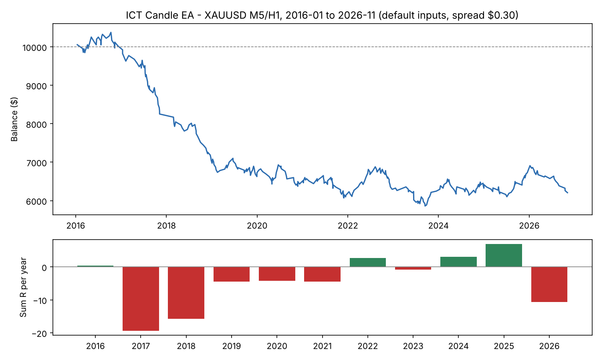

# Backtest ICT Candle EA (Python port)

พอร์ตตรรกะของ `MQL5/Experts/ICT_Candle_EA.mq5` มาเป็น Python/numba เพื่อเทสกับข้อมูลยาว

- ตัดสินใจตอนแท่ง M5 ปิด (เหมือน EA), จำลองการเข้า/SL/TP/กันทุน/ปิดบางส่วนบนแท่ง M1
- กติกาแบบระวัง: แท่ง M1 เดียวโดนทั้ง SL และ TP = นับ SL, ไม่ให้ TP ในแท่งที่ Limit เพิ่ง fill
- เวลา "เซิร์ฟเวอร์" = เวลานิวยอร์ก + 7 ชม. (ตรงกับ `InpServerMinusNY = 7`)
- ทองคำ: 1 lot = 100 oz, spread คงที่ $0.30 (ปรับได้)

## ข้อมูล
XAUUSD M1 จาก HistData.com (เวลา EST คงที่ UTC-5) ม.ค. 2016 - พ.ย. 2026
ไฟล์ข้อมูลไม่ได้ commit (ใหญ่) ให้โหลด zip รายปีจาก histdata.com แล้วแตกไว้ที่ `backtest/csv/`

```bash
pip install numpy pandas numba
python3 prep.py backtest        # csv/ -> data.npz
python3 run.py                  # ผลค่าเริ่มต้น + trades_base.csv
```
ใน Python: `from run import go, stats; T,*_ = go(disp=1.5); print(stats(T))`

## ผลค่าเริ่มต้น (XAUUSD M5/H1, ทุน $10,000, เสี่ยง 1%/ไม้)
| ไม้ | Win% | เฉลี่ย R | PF | ผลรวม | Max DD |
|---|---|---|---|---|---|
| 348 | 42.5 | -0.135 | 0.74 | -37.9% | -43.5% |


